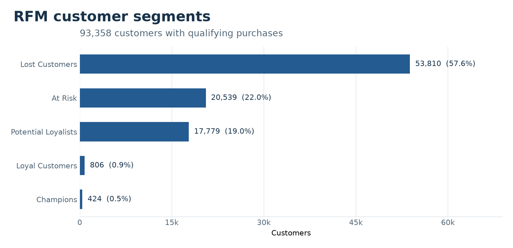
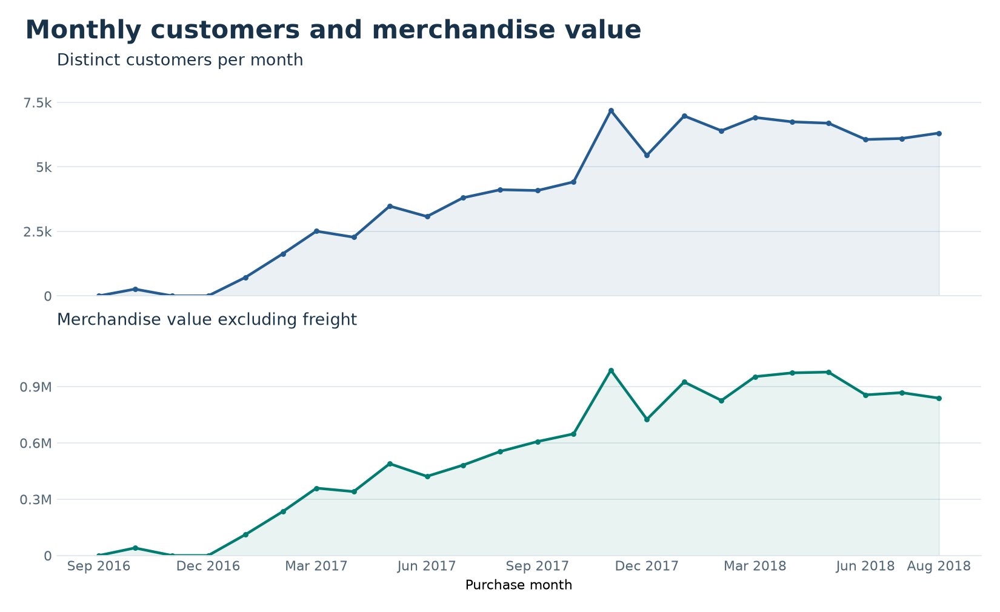
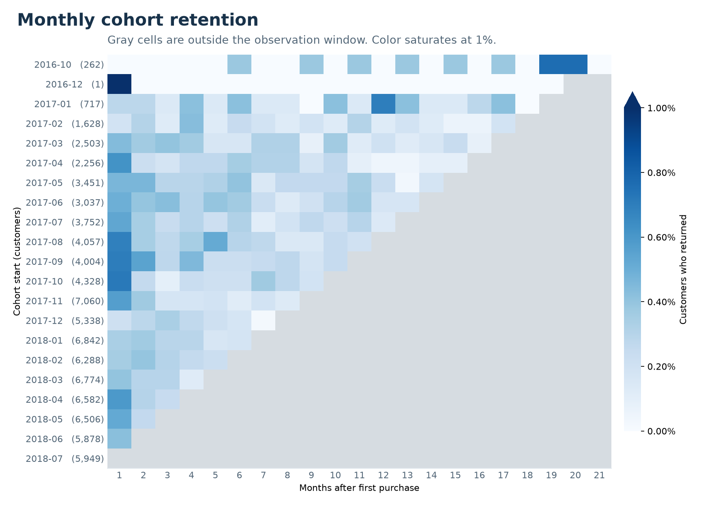

# Olist customer and sales insights

These charts use qualifying purchases, defined as delivered orders with item rows. The dataset contains **93,358 customers**, **96,478 qualifying orders**, and **13,221,498.11** in merchandise value. Merchandise value excludes freight. [SQL analysis](sql_analysis.md)

## Most customers made one purchase



**53,810 customers (57.6%)** were in the Lost Customers segment. These customers made one qualifying purchase more than 180 days before the RFM reference date. The label describes their observed purchase history.

**17,779 Potential Loyalists** were recent one-time buyers. This group provides a starting point for measuring how many new buyers make a second purchase. Across the full dataset, **2,801 customers (3.00%)** made at least two qualifying purchases. [RFM analysis](rfm_analysis.md)

## November 2017 was the highest-value month



November 2017 recorded **7,183 distinct customers** and **987,765.37** in merchandise value, the highest observed month for both measures. The monthly customer count includes each customer once within that month. A customer who buys in multiple months appears in each of those months.

The chart runs from the first through the last month with a qualifying purchase and keeps any zero months in between. The first qualifying purchase was September 15, 2016, and the last was August 29, 2018. The boundary months cover part of their respective calendar months under the project's observation rule. [Monthly SQL results](sql_analysis.md)

## Few buyers returned the next month



Among cohorts with a fully observed Month 1, **390 of 81,264 customers (0.48%)** purchased again in the next calendar month. The November 2017 cohort had **40 returning customers out of 7,060 (0.57%)** in Month 1. The full-period repeat-purchase percentage measures return purchases at any later point, including repeat orders within the first month.

The heatmap starts at Month 1 because Month 0 is always 100%. Gray cells are outside the observation window. The color scale tops out at 1% so differences below 1% remain visible. The dark December 2016 Month 1 cell is **100% from one customer**. The rates CSV preserves the values used for the heatmap, including rates above 1%. [Cohort analysis](cohort_analysis.md)

## Reproduce the charts

From the project root, run the following after generating the cleaned, RFM, and cohort CSVs.

```powershell
.\.venv\Scripts\python.exe -B -m src.analysis.visualize_results
```

The script saves the three PNGs in `docs/figures/`. The monthly chart reuses the same qualifying orders and exact item-price totals as RFM. The other two charts read the previously verified RFM and cohort results.
