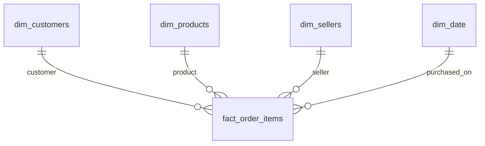

# Olist data warehouse design

The warehouse uses one fact table with four dimensions. The fact table stores the item sold and its amount. The dimensions give the item context about the customer, product, seller, and purchase date. The [MySQL schema](../sql/schema.sql) defines the tables and their keys.

## What one row represents

The **grain** is one row per order item. The primary key is the pair `(order_id, order_item_id)` because the item number can repeat across orders. An order with two items produces two fact rows. Sum `price` for merchandise value and use `COUNT(DISTINCT order_id)` for order counts.

Each fact row has four required foreign keys. A foreign key links an item to an existing row in a dimension. Several items can share the same customer record, product, seller, or date. InnoDB enforces these links. [MySQL 8.0 foreign key documentation](https://dev.mysql.com/doc/refman/8.0/en/create-table-foreign-keys.html)

## Tables and sources

| Table | What it stores | Key | Rows expected |
| --- | --- | --- | ---: |
| `dim_customers` | One row per cleaned customer record with location and both customer IDs | Generated `customer_key` | 99,441 |
| `dim_products` | One row per cleaned product with Portuguese category, English label, and translation status | Generated `product_key` | 32,951 |
| `dim_sellers` | One row per cleaned seller with location | Generated `seller_key` | 3,095 |
| `dim_date` | One row per calendar day, with year and month | `full_date` | 774 |
| `fact_order_items` | One row per cleaned item, with order status, purchase date, merchandise price, and freight | `(order_id, order_item_id)` | 112,650 |

The customer, product, and seller keys are **surrogate keys**, meaning MySQL generates a number to identify each dimension row. Their original Olist IDs stay unique in those dimensions so the loader can find the right key. The date uses the actual `DATE` as its key because each calendar day is already unique.

The customer dimension keeps one row per `customer_id`, the identifier in the orders CSV. This preserves the location recorded for that customer record. Use `customer_unique_id` for analysis across purchases. The same identity can appear on multiple dimension rows.

## How cleaned records map to the warehouse

1. Read the customer, product, and seller dimensions from the cleaned CSVs. The product CSV already includes English category labels where available. The 610 blank categories and 13 products with untranslated labels keep their translation statuses.
2. Generate every calendar day from the earliest to the latest purchase date in the orders CSV, September 4, 2016 through October 17, 2018. A complete calendar lets monthly queries account for days without a purchase.
3. Match each item to its order by `order_id`. Use the order's `customer_id` and purchase date and the item's `product_id` and `seller_id` to find the four dimension keys.

The 112,650 item rows cover 98,666 distinct orders. The 775 orders without items remain in the cleaned orders CSV for lifecycle analysis. Because every fact row already has an item, filtering the fact table to `order_status = 'delivered'` applies the cleaning milestone's qualifying-purchase rule. This selects 110,197 item rows across 96,478 orders. For customer purchase value, sum `price` and report freight separately.

## Data types

- Use `CHAR(32)` for Olist IDs and `CHAR(5)` for ZIP prefixes to preserve leading zeroes. Use `VARCHAR` for names, categories, and status.
- Use `INT UNSIGNED` for generated keys and `SMALLINT UNSIGNED` for the item number. The highest observed item number is 21.
- Use `DATE` for purchase days. Day-level detail supports recency and monthly cohorts. The cleaned files retain the full timestamps and fulfillment flags.
- Use `DECIMAL(10,2)` for prices and freight to store cents exactly. The largest observed amounts are 6,735.00 for price and 409.68 for freight. [MySQL 8.0 numeric type documentation](https://dev.mysql.com/doc/refman/8.0/en/numeric-type-syntax.html)

## Recruiter explanation

> I set the grain to one row per order item because each item has its own product, seller, and price. I joined the item table to four lookup tables for customer, product, seller, and date. I can sum item prices for merchandise sales, but I count distinct order IDs for purchase frequency so a two-item order counts once. I group by the stable customer identity to track repeat purchases.

## Verification

The design was checked against the cleaned files for unique keys, matching references, row counts, field lengths, and numeric ranges. The schema was reviewed for dimension-before-fact order and matching foreign key types. Executing the schema on MySQL and loading rows belong to Milestone 4.
